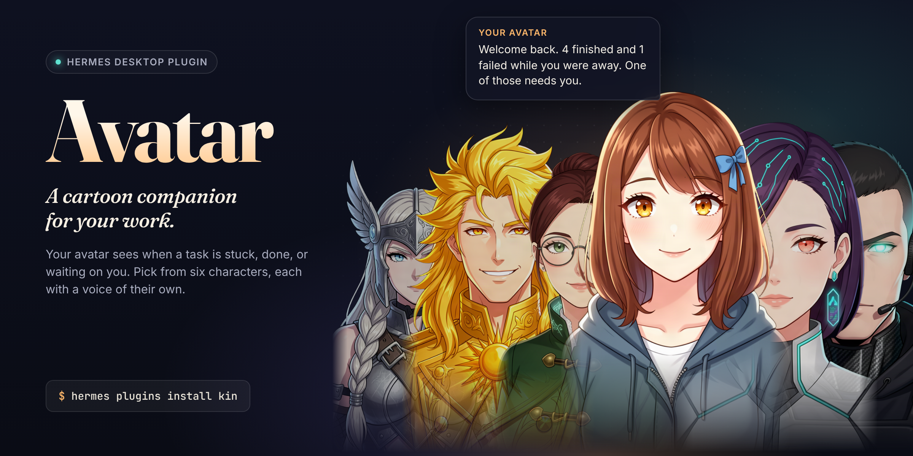
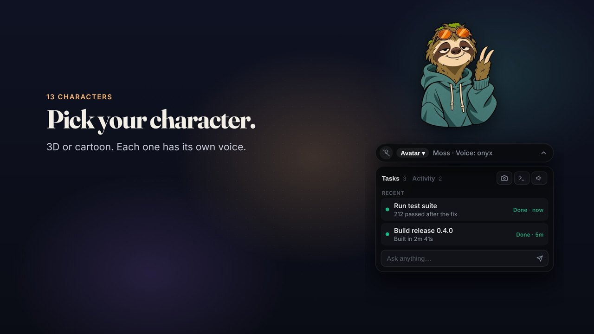
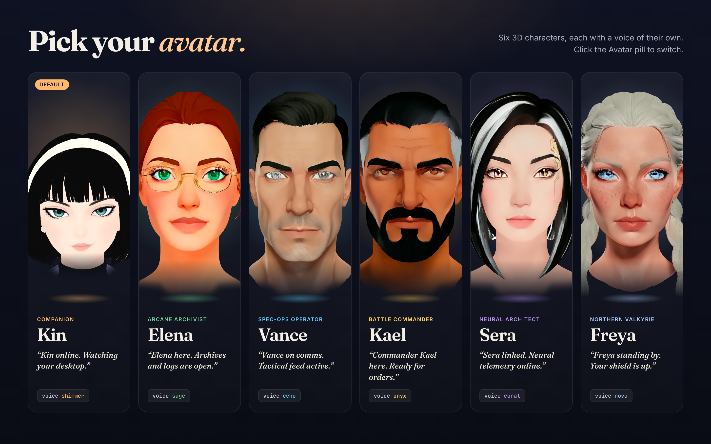
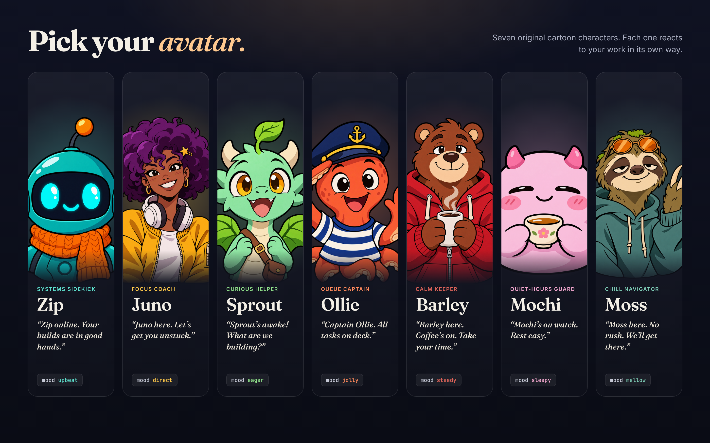

# Avatar



Avatar (plugin name `kin`) gives [Hermes Desktop](https://hermes-agent.nousresearch.com/docs/user-guide/desktop) a face. Pick a 3D or cartoon character. It watches your Hermes sessions, frowns when a step fails, grins when a turn finishes, and shows what Hermes is doing right now.

[](docs/demo.mp4)

▶ [Watch the demo](docs/demo.mp4) · [vertical version](docs/demo-vertical.mp4)

Pick one of thirteen original characters: six 3D busts and seven 2D cartoons. Each one has a voice of their own.





An optional **floating overlay** (`overlay/`) puts your avatar on top of your desktop. Its eyes follow your cursor. A task drawer shows what Hermes is doing in plain English, and you can talk to Hermes by voice. The overlay is strictly opt-in.

## What it does

**The Hermes plugin** (this repository's root — hooks, dashboard routes, and a Desktop pane):

- A floating 3D head in the pane, from `assets/kin-bust.glb`. She hovers with a soft glow under the chin, blinks with a curved lid, follows the pointer, and changes her mouth with the mood. Thinking tilts up with a swirl. Watching turns toward the pointer. Concern droops with a sweat drop. Pleasure hops and blushes. Rest leans, dims, lowers her lids, and floats a z. Motion is capped at 30 fps, pauses while hidden, and calms when the system asks for reduced motion.
- Moods from Hermes events: thinking, attentive, watching a tool, concerned, pleased, dozing.
- Loop sentinel. The same tool with the same arguments failing 3 times in one turn offers a different approach.
- Welcome back. After the window has been away for 10 minutes, and only if something finished or failed meanwhile, Kin says what happened in two sentences.
- Long task. A turn that stays busy for 3 minutes gets an OS notification when it ends, if you are away.
- Plain-words errors. Provider and turn errors become one line and one composer draft.
- Pet bubble lines through `ctx.pet.say`, at most one unprompted line every 10 minutes. Mute, sleep, and quiet hours hold the line.
- Suggestions are composer drafts. Kin never sends them.
- Slash commands: `/kin status|mute|sleep|wake|quiet|memory|wipe|wrapup`.

**The floating overlay** (`overlay/`, optional companion app):

- The character floats over your desktop (Hyprland). Her eyes track your real cursor position via the Hyprland socket — zero-spawn, anchored to the overlay's own on-screen position, so it works on any monitor.
- A capsule bar shows the live status line ("Running terminal…"), the persona switcher, and the mic toggle. A right-click on the persona opens a character picker; each character is a hand-rigged 3D bust with her own voice.
- The drawer underneath is plain English, grouped **Running / Queued / Recent**: active sessions with their real last activity, background processes named by the session that started them ("Launch Titanfall 2 VR mod — 5 background processes — 12h"), plan checklist items, and a per-tool event feed. Every row is two lines (what it is + what it's doing) with a colored status and age. Click a row to jump to that session.
- **Voice, opt-in only.** The mic never starts by itself — you toggle it on. Capture uses the browser `getUserMedia` API (each OS shows its own permission prompt; the system default input device is used), and transcription uses a local whisper.cpp build when one is installed, otherwise Hermes's own STT path (which filters known Whisper hallucinations). A transcript lands in the Hermes composer as a **draft you review and send** — voice never auto-sends. Two guards stop hallucination storms: ~0.5 s of speech before an STT call is spent, and identical consecutive transcripts are dropped within a 10-minute cooldown (logged to the event feed).
- Quick actions (icon buttons): **camera** — screenshot the active window, OCR it, ask Hermes about it; **terminal** — OCR the active terminal, ask Hermes to diagnose it; **speaker** — a spoken recap of what is active.
- A one-time onboarding trio explains the head click, the opt-in mic, and the snap action the first time the overlay runs.
- Ask row with ArrowUp/ArrowDown history recall.

### How the two halves talk

```
overlay (Electron)                Hermes plugin                     Hermes
  voice ────────write──▶ settings.pending_draft ──GET /outbox──▶ desktop pane polls every 450 ms
  buttons/asks ─write─▶ settings.pending_prompt        (read-and-clear, one write = one submit)
                                                          │
                              pane: drafts via host.composer.setDraft (voice, never auto-sent)
                                   submits via host.composer.submit (explicit asks)
                                                          ▼
                                                   focused Hermes chat
```

The overlay writes to the plugin's own SQLite settings table; the gateway dashboard route `GET /outbox` reads-and-clears each key atomically; the Desktop pane acts through the plugin SDK. No gateway patching, no socket sniffing, no second agent.

Spoken lines ride the same table: the overlay writes `pending_speech`, `GET /outbox` hands it to Hermes's own `text_to_speech` tool, and the overlay plays the file the plugin stores in `speech_ready`. The overlay never holds a provider key.

## Privacy and disclosures

- The **plugin** captures no microphone, camera, or screen. It uses Hermes gateway events, the focused session, and its own memory only. No telemetry and no `ctx.llm` calls: recaps are counted from stored events, not summarized by a model. No secrets: nothing is read from `.env`, `auth.json`, or another tool's credential store. No shell commands, no background process, no patches to Hermes.
  - Its one network path: when the overlay asks for a spoken line, the plugin's `/outbox` route calls Hermes's own `text_to_speech` tool (the published `tools.registry` API). Hermes picks the TTS provider and holds its key; the plugin only gets back an audio file path.
- The **overlay** is a separate app you run yourself. Everything it does:
  - **Microphone**, only after you toggle it on. It starts off at every launch, and says "Mic not found" instead of spinning if no mic is available.
  - **Speech to text:** a local whisper.cpp build (`whisper-cli`) when installed. Otherwise it runs `python3` to call Hermes's `tools.voice_mode.transcribe_recording`, which uses Hermes's configured STT provider and key. The overlay never reads a key.
  - **Spoken lines:** the overlay asks the Kin plugin, which uses Hermes's `text_to_speech` tool (above). It plays the audio in its window, or with `ffplay` as a fallback.
  - **Persona voice changes Hermes's voice.** Switching persona runs `hermes config set tts.openai.voice <voice>` and `hermes config set voice.gpt_live.voice <voice>`. That sets the TTS voice for all of Hermes, not just the overlay. To change it back, run the same command with the voice you want.
  - **Screen capture** of the active window or terminal uses the OS tool (`grim` on Linux, `screencapture` on macOS, PowerShell on Windows), and OCR uses `tesseract` when installed. Only when you click the camera or terminal button.
  - **Window queries** use the Hyprland socket and `hyprctl` on Linux, and AppleScript or Win32 on macOS and Windows. Focusing Hermes uses `open` (macOS) or PowerShell (Windows).
  - **Reads** `~/.hermes/state.db` (read-only) for sessions, turns, and background processes, to draw the task drawer.
  - **Writes** the Kin plugin's own SQLite table and the two Hermes config keys above. Nothing else.
  - **Network:** only the STT and TTS calls Hermes makes for it. No telemetry, no accounts.

Memory is a SQLite file in the profile plugin-data directory (`plugin_db("kin")`). It keeps tool names, success or failure, a short error line, and wrapup notes — not transcripts or tool arguments. `/kin wipe` clears it.

## Install

Requires Hermes 0.22.0 or newer. Checked on Hermes Agent v0.23.0 on Omarchy (Hyprland, Wayland).

**Plugin** (hooks, dashboard routes, Desktop pane):

```bash
hermes plugins install "file://$(pwd)" --enable --yes-deps
```

Or, once listed in the catalog: `hermes plugins install kin`.

Hermes Desktop then needs one click, because the host leaves every desktop plugin off until you allow it: Capabilities, Plugins, enable Kin. If the pane is missing, use Rescan, then Reload desktop plugins.

**Floating overlay** (optional; Node 22+, Electron — Linux, macOS, and Windows):

```bash
cd overlay
npm install        # electron + three
./run.sh           # Linux / macOS    (run.bat on Windows, or: npm start)
```

Per-platform notes: gaze works everywhere via Electron's screen API. Snap/Term screenshots use `grim` on Linux, `screencapture` on macOS, and PowerShell's `CopyFromScreen` on Windows; OCR uses `tesseract` when installed (otherwise the prompt still attaches the screenshot for Hermes's vision). Window awareness uses the Hyprland socket on Linux and AppleScript / Win32 probes on macOS and Windows. It works without the plugin too, but the relay, moods, and task drawer need the plugin installed and enabled.

Optional, for fully offline voice: install whisper.cpp with a ggml model at `~/.local/opt/whisper.cpp/models/` (or point `KIN_WHISPER_BIN` and `KIN_WHISPER_MODEL` at your build) — Kin picks it up automatically.

## Slash commands, in a Hermes session

```text
/kin status
/kin mute on
/kin mute off
/kin sleep
/kin wake
/kin quiet 22:00 07:00
/kin quiet off
/kin memory
/kin wipe
/kin wrapup
```

`/kin wrapup` stores a short handoff note. The next session's first turn can include it, unless Kin is muted or asleep.

## Develop

`desktop/plugin.js` is the built bundle of the pane (esbuild + Three.js, with the bust inlined as a fallback). The overlay is plain Electron: `overlay/main.js` (main process) and `overlay/index.html` (renderer + UI). `kin-avatar.js` and `kin-2d.js` are the avatar engines — treat them as assets.

## Layout

```text
plugin.yaml            Python manifest
__init__.py            hooks and /kin
logic.py               behavior rules
memory.py              local SQLite
dashboard/             plugin_api.py routes (the /outbox relay)
desktop/plugin.js      bundled desktop pane
desktop/kin-bust.glb   the bust, loaded beside the bundle
assets/kin-bust.glb    source copy of the bust
assets/MODEL.txt       what the bust is, and what it is not
overlay/               the optional floating HUD (Electron app)
docs/                  banner, cast sheets, demo videos, and their sources (promo-src/)
DEMO.md                the 90-second demo script
```

## License

MIT — see `LICENSE`.
